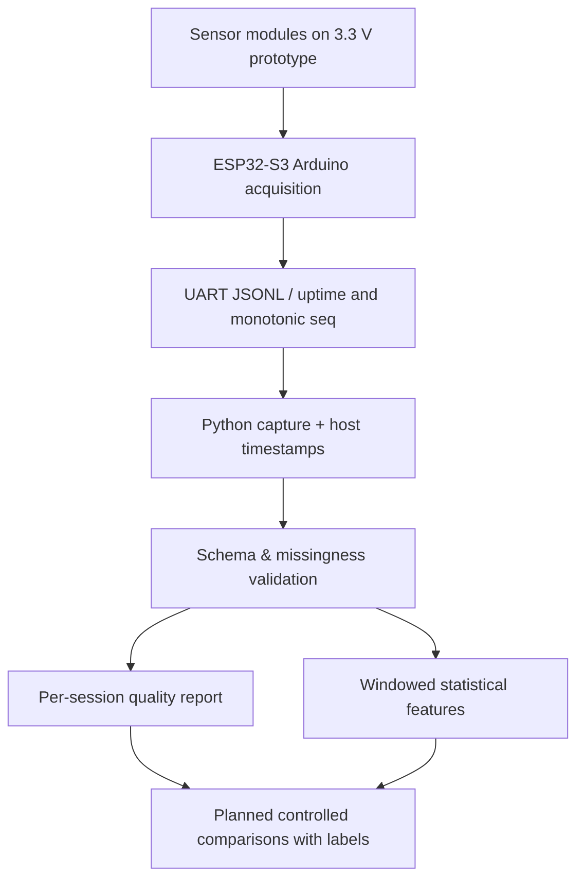

# EdgeSense ESP32-S3 — Quality-Aware Multimodal Sensing

**Independent experimental software and hardware-integration starter**
**Taha Mohammadi · ESP32-S3 / Arduino C++ · Python · I²C · OneWire · Sensor Data Quality**

> **STATUS — NOT HARDWARE VALIDATED.** Source code, simulation, and host tests are supplied. The photographed ESP32-S3-WROOM-N16R8-like camera board has **not yet been powered, flashed, or validated with these sensor modules**. Hardware pin assignment is *provisional*. No sensor measurements, model scores, manufacturing anomaly results, PPG health estimates, clinical data, or experimental findings are claimed. This is independent of ADaMS Lab/University of Alberta.

## What this repository does

This repository covers the part of sensor-fusion research often skipped in ML examples: **sensor acquisition → traceable transport → explicit signal missingness → windowed features → inspectable quality report**. It contains two mutually exclusive ESP32-S3 firmware profiles using the same serial JSONL protocol:

| Profile | Sensors | Observable signals | Status |
|---|---|---|---|
| `edgesense` | MPU6050, MLX90614, DS18B20 | 3-axis acceleration, 3-axis angular velocity, IR object/ambient temperature, contact temperature | code written; hardware integration pending |
| `ppg_motion` | MAX30102, MPU6050 | raw/low-level red & IR counts, accelerometer/gyroscope | code written; hardware integration pending |

**Not built yet:** camera/OV5640 pipeline, motor control, ROS, adaptive fusion classifier, true time synchronization, clinical inference. Additional inventory assets are documented in `hardware/INVENTORY.md`.

## End-to-end architecture



## Fast software-only verification (no device necessary)

```powershell
py -3.12 -m venv .venv
.\.venv\Scripts\python.exe -m pip install -e ".[test,serial]"
.\.venv\Scripts\python.exe -m pytest -q
.\.venv\Scripts\python.exe -m edgesense.cli simulate --frames 200 --out data/synthetic/fixture.jsonl
.\.venv\Scripts\python.exe -m edgesense.cli audit --input data/synthetic/fixture.jsonl --out reports/synthetic_quality.json
.\.venv\Scripts\python.exe -m edgesense.cli features --input data/synthetic/fixture.jsonl --out reports/synthetic_features.csv
```

`simulate` generates **artificial, labeled-as-synthetic** fixture streams for testing the pipeline. They are **NOT recordings** and must never be reported in an academic CV as measured performance. Raw data and reports are ignored in `.gitignore`.

## Flash the firmware (only after verifying PCB and voltages)

1. Read [`hardware/WIRING_AND_SAFETY.md`](hardware/WIRING_AND_SAFETY.md) first. Confirm supply rails, GPIO continuity, and actual module voltages with a multimeter. Header pins must be soldered securely.
2. Install [PlatformIO](https://platformio.org/install/cli) (`python -m pip install platformio`) and appropriate USB-UART driver, if needed.
3. Connect **only USB-UART**, without body electrodes, battery module, motor driver, or unknown sensor supplies.
4. Verify `firmware/platformio.ini` matches the actual N16R8 *module*, board boot mode and serial interface. `esp32-s3-devkitc-1` is a generic build target and **is not the PCB's schematic**.
5. For environment mode, after confirming the provisional wiring:

```powershell
pio run -d firmware -e edgesense
pio run -d firmware -e edgesense -t upload --upload-port COM5
pio device monitor --port COM5 --baud 115200
```

For motion + PPG, attach only the independently verified PPG module and IMU, then use `-e ppg_motion`. **Replace COM5 with your real COM port.** Never connect AD8232 electrodes to a person on a USB-powered experimental rig.

## Record real data

```powershell
edgesense capture --port COM5 --seconds 120 --out data/raw/session001.jsonl
edgesense audit --input data/raw/session001.jsonl --out reports/session001_quality.json
edgesense features --input data/raw/session001.jsonl --out reports/session001_features.csv
```

Host `host_received_utc` is a host arrival timestamp, **not sensor sample UTC**. `uptime_ms` is a device clock since boot. Serial host timestamps alone do not establish inter-device synchronization or transfer latency. Each emitted sensor frame has `session`, `seq`, `mode`, `schema`, and `uptime_ms`. Missing fields are always `null`, never `0` substitutes. For DS18B20, `contact_c` is the most recent cached conversion: `contact_new` and `contact_age_ms` explicitly distinguish fresh conversions from carried-forward values. A non-null value is NOT a new measurement.

The firmware emits approximately **20 frames/s** for the environment mode and **50 frames/s** for motion/PPG; these are scheduling targets, not validated acquisition frequencies. MLX readings may be re-sampled and PPG FIFO overrun is possible. The quality report's `lost_sequence_numbers_lower_bound` detects **transport loss after firmware frame creation**, not missed ADC/PPG conversions.

## Research questions (not answered yet)

- **RQ1.** What proportion of expected acquisition frames and sensor values remain usable under stationary vs manually perturbed conditions?
- **RQ2.** Does combining 1-second temperature and IMU features improve an **explicitly labeled, controlled** task versus either modality alone?
- **RQ3.** Can IMU-derived motion features predict *reference-defined* PPG artifact segments? No heart rate/SpO₂ or diagnostic accuracy claim.
- **RQ4.** How do sensor disconnections, I²C timing faults and UART transport affect false-confidence risk?

See [`experiments/PROTOCOL.md`](experiments/PROTOCOL.md) for preregistration-style plan, repeated trials, limitations, and evaluation decisions.

## Repository map

```text
firmware/
  platformio.ini       two ESP32-S3 build profiles
  include/pins.h       PROVISIONAL board-specific pins
  src/main.cpp         MPU6050 + MLX90614 + DS18B20
  src/ppg_motion.cpp   MAX30102 + MPU6050
host/edgesense/        parsing, recording, audit, feature extraction
hardware/              supplied inventory + safety requirements
experiments/           evaluation plan and evidence ledger
tests/                 offline Python tests
.github/workflows/     Python CI + optional PlatformIO static builds
examples/              explicitly synthetic protocol fixtures
```

## Reproducibility and authorship

- No UCI datasets are included: previous independent benchmarks remain in separate repositories ([Sensor Dropout](https://github.com/tahamohamadi-ir/sensor-dropout-robustness), [Hydraulic Fusion](https://github.com/tahamohamadi-ir/hydraulic-multisensor-fusion)).
- Shared software is MIT licensed; sensor/module specifications and third-party firmware libraries retain their own licenses. No external library source is copied into the repository.
- Hardware bill of materials is an applicant-provided inventory, **not** a completed hardware validation record.
- A successful CI run verifies software/test workflows, not electrical wiring, biological measurements, camera pinout or model usefulness.

## External references

- [Espressif ESP32-S3 GPIO constraints](https://docs.espressif.com/projects/esp-idf/en/stable/esp32s3/api-reference/peripherals/gpio.html)
- [ESP32-S3 module datasheet](https://www.espressif.com/sites/default/files/documentation/esp32-s3-wroom-1_wroom-1u_datasheet_en.pdf)
- [Adafruit MPU6050 Arduino driver](https://github.com/adafruit/Adafruit_MPU6050)
- [Melexis MLX90614](https://www.melexis.com/en/product/MLX90614/Digital-Plug-Play-Infrared-Thermometer-TO-Can)
- [Analog Devices MAX30102](https://www.analog.com/media/en/technical-documentation/data-sheets/MAX30102.pdf)
- [Analog Devices DS18B20](https://www.analog.com/media/en/technical-documentation/data-sheets/DS18B20.pdf)
